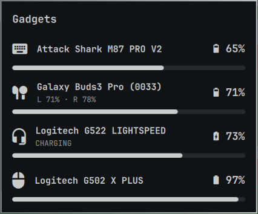

# Gadget Batteries for Omarchy

The battery of every gadget you have connected, in one Omarchy bar widget:
mice, keyboards, headsets, earbuds and anything you can feed it with a script.
It replaces separate AirPods, Logitech and headset widgets with a single one.

<p align="center"></p>

[Español abajo](#español)

## Install

```bash
omarchy plugin add https://github.com/69Harold69/omarchy-gadget-batteries --enable
```

The widget lands on the right of the bar. It hides itself while no gadget
reports a battery, so an empty bar slot right after installing is normal:
connect a wireless gadget, or run `upower -d` to see which devices (and
batteries) your system detects. Review the code before enabling it: Omarchy shell plugins
run unsandboxed with your user permissions.

## What it reads

| Source | Gadgets | Needs |
|---|---|---|
| UPower | Bluetooth mice, keyboards and headphones, Logitech receivers, game controllers | nothing (ships with Omarchy) |
| [Solaar](https://github.com/pwr-Solaar/Solaar) | Logitech HID++ devices, with the real level and charging state even on the charging cable | `solaar` (optional) |
| [HeadsetControl](https://github.com/Sapd/HeadsetControl) | USB / 2.4 GHz headsets: Logitech G, SteelSeries, HyperX, Corsair, Roccat, ... | `headsetcontrol` (optional) |
| [Omarchy Buds](https://github.com/dgalarza/omarchy-buds) | Galaxy Buds, per earbud and case | the Omarchy Buds plugin + GalaxyBudsClient (optional) |
| Google Fast Pair | Per-earbud battery of Sony, JBL, Jabra, Nothing, Soundcore, Pixel Buds and other Fast Pair earbuds | `python-dbus`, `python-gobject` (ship with Omarchy) |
| Apple BLE adverts | AirPods and Beats, per pod and case. Only adverts whose model matches your connected pair; scans 6 s every 5 minutes (right away while the panel is open) | `python-dbus` |
| Xinmeng 2.4G dongle | Keyboards made by Xinmeng on the `0c45:fefe` dongle: Attack Shark M87 PRO V2, M87 Lite, C87 | the udev rule below |
| Your own JSON / scripts | anything | see [Add your own gadgets](#add-your-own-gadgets) |

Install the optional tools you need with `omarchy pkg add solaar headsetcontrol`.
When two sources report the same gadget, it is listed once, from the more
detailed source.

## What it does

- **Bar:** a fixed "devices" icon. Hover for a summary, click for the panel.
- **Panel:** every gadget with its icon, level, a level bar and, for earbuds,
  each earbud and the case. Click a Logitech gadget to open Solaar, Galaxy Buds
  to open GalaxyBudsClient.
- **Charging:** shown when the gadget reports it. When it does not (a Logitech
  mouse on its cable reports "unknown"), a level that rose in the last 20
  minutes shows as *charging (estimated)*.
- **Notifications:** low battery (15% by default) once until it charges, and
  fully charged once per charge.
- **Disconnects:** gadgets out of reach disappear within 15 seconds; a source
  that stops answering shows its gadgets dimmed as offline.
- **Several monitors:** one widget per bar, but the background work and the
  notifications happen once.
- **Language:** Spanish when your locale is Spanish, English otherwise.

## Settings

```bash
omarchy bar set io.github.69harold69.gadget-batteries <key> <value>
```

| Key | Default | Meaning |
|---|---|---|
| `barIcon` | `fixed` | `lowest` shows the icon of the gadget with the least battery |
| `showPercentage` | `false` | Show the lowest percentage next to the icon |
| `lowThreshold` | `15` | Low-battery notification threshold. `0` turns low-battery notifications off |
| `externalPath` | `~/.cache/omarchy-accessories/external.json` | External JSON file |
| `names` | `{}` | Rename gadgets, e.g. `--json '{"M87 keyboard (2.4G)": "Attack Shark M87 PRO V2"}'` |

## Xinmeng 2.4G keyboards (Attack Shark M87 PRO V2)

The battery query goes to the dongle's vendor interface, which Linux keeps
root-only. This rule opens **only that interface** (USB interface 03, usage
page `0xFF60`) to the logged-in user; the interfaces that carry keystrokes stay
root-only:

```bash
sudo cp ~/.config/omarchy/plugins/io.github.69harold69.gadget-batteries/setup/70-gadgets-xinmeng-dongle.rules /etc/udev/rules.d/
sudo udevadm control --reload && sudo udevadm trigger --subsystem-match=hidraw
```

Protocol: an output report `20 01` is answered with `20 01 ?? <battery>`. It
comes from Xinmeng's own "M87 keyboard" app 1.0.0.8. That app also sends
commands `0x0f` and `0x1f`, which change the keyboard's configuration; this
plugin never sends them. In Bluetooth mode the keyboard shows up through
UPower without the rule.

## Add your own gadgets

Write a JSON array to `~/.cache/omarchy-accessories/external.json` (watched,
changes appear immediately), or drop an executable in
`~/.config/omarchy/gadget-batteries/collectors.d/` that prints the same array
(run once a minute, 20 s timeout):

```json
[{"id": "speaker", "name": "Kitchen Speaker", "kind": "speaker", "pct": 64,
  "charging": false, "ts": 1750000000, "ttl": 900,
  "left": -1, "right": -1, "case": -1}]
```

- `kind`: mouse, keyboard, touchpad, pen, headset, headphones, earbuds,
  gamepad, speaker, phone, tablet, watch.
- `ts` + `ttl` (seconds): past them the gadget shows as offline.
- `left` / `right` / `case` are optional per-part levels.

The format is the one of
[theleif/omarchy-peripheral-batteries](https://github.com/theleif/omarchy-peripheral-batteries),
so collectors work with both.

## Remove

```bash
omarchy plugin remove io.github.69harold69.gadget-batteries
rm -rf ~/.cache/omarchy-gadget-batteries ~/.config/omarchy/gadget-batteries
sudo rm -f /etc/udev/rules.d/70-gadgets-xinmeng-dongle.rules   # if you installed it
```

## How it works

| File | Role |
|---|---|
| `Panel.qml`, `Model.js` | Bar widget, panel and the pure logic (merging, charging inference, notifications) |
| `collect` | Runs every collector once a minute behind a lock, shared by all bars |
| `collectors.d/` | `logitech-solaar`, `airpods`, `xinmeng-dongle` |
| `sources/gfps-daemon` | Single-instance wrapper that follows connected audio devices with `gfps-reader` |
| `sources/gfps-reader` | Google Fast Pair message-stream reader from [Omaphones](https://github.com/ncr/omarchy-headphones) (MIT) |
| `notify-once` | De-duplicates notifications across bars |

State lives in `~/.cache/omarchy-gadget-batteries/`. Tests:
`node tests/model.test.mjs` and `python3 tests/collectors_test.py`. After
editing the plugin, run `omarchy restart shell`.

## License

MIT. `sources/gfps-reader` is MIT, © its authors; see
[THIRD_PARTY_NOTICES.md](THIRD_PARTY_NOTICES.md).

---

## Español

La batería de todos tus gadgets conectados en un solo widget de la barra de
Omarchy: mouse, teclados, audífonos, earbuds y lo que quieras agregar con un
script. Reemplaza los widgets separados de AirPods, Logitech y audífonos por
uno solo.

**Instalar:**

```bash
omarchy plugin add https://github.com/69Harold69/omarchy-gadget-batteries --enable
```

Si después de instalarlo no ves el icono, es normal: el widget se oculta
mientras ningún gadget reporta batería. Conecta uno inalámbrico, o corre
`upower -d` para ver qué dispositivos (y baterías) detecta tu sistema.

**Qué reconoce:** dispositivos Bluetooth y receptores Logitech (UPower),
Logitech con Solaar (incluso cargando por cable), audífonos USB/2.4 GHz con
HeadsetControl, Galaxy Buds por auricular, earbuds con Google Fast Pair (Sony,
JBL, Jabra, Nothing, Soundcore, Pixel Buds...), AirPods/Beats y teclados
Xinmeng por su dongle 2.4G (Attack Shark M87 PRO V2). Herramientas opcionales:
`omarchy pkg add solaar headsetcontrol`.

**Qué hace:** icono fijo en la barra con resumen al pasar el mouse; panel con
nivel, barra y detalle por auricular; estado *cargando* (o *cargando
(estimado)* si el % sube sin que el dispositivo lo reporte); avisos de batería
baja y de carga completa; los gadgets desconectados desaparecen en 15 s. Los
textos salen en español si tu sistema está en español.

**Ajustes:** los mismos de [Settings](#settings). Para no recibir avisos de
batería baja usa `lowThreshold` en `0`:
`omarchy bar set io.github.69harold69.gadget-batteries lowThreshold 0`.

**Teclado Attack Shark M87 PRO V2 por dongle:** instala la regla de la sección
[Xinmeng 2.4G keyboards](#xinmeng-24g-keyboards-attack-shark-m87-pro-v2). Solo
abre la interfaz de la batería, nunca las que transmiten lo que tecleas. Para
ponerle tu nombre:

```bash
omarchy bar set io.github.69harold69.gadget-batteries names --json '{"M87 keyboard (2.4G)": "Attack Shark M87 PRO V2"}'
```

**Agregar tus propios gadgets:** escribe un JSON en
`~/.cache/omarchy-accessories/external.json` o pon un script en
`~/.config/omarchy/gadget-batteries/collectors.d/` (formato arriba, en
[Add your own gadgets](#add-your-own-gadgets)).

**Desinstalar:** ver [Remove](#remove).
